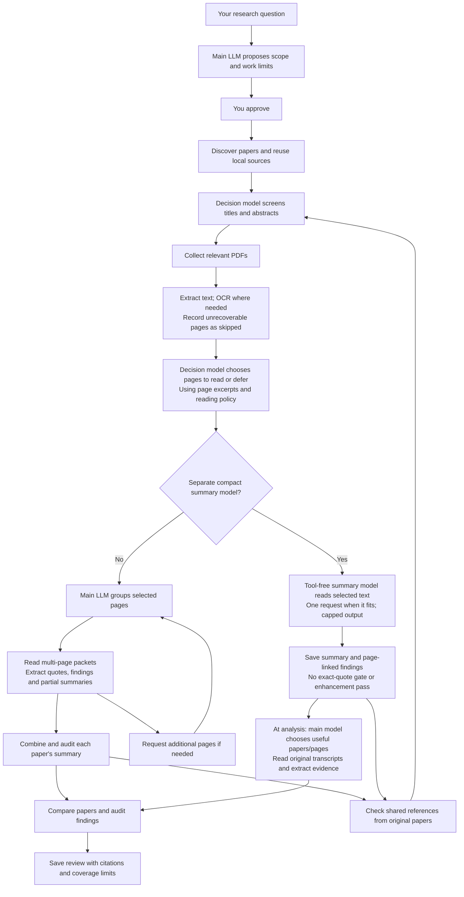

# ScholarWeave

ScholarWeave is a local-first assistant for conversation, exploring ideas, working with documents,
and looking things up on the web. Start with your question; use papers and notes as sources when
relevant, and save summaries or other outputs only when you need them.

Connect Ollama, your own OpenAI-compatible server, or a hosted service with your own API key.
Your library is stored on your machine; model inference runs with the provider you choose.

## Features

### Chat, Local Sources, And Web Lookup

- Search the web, arXiv, and Wikipedia; acquire PDF papers and web sources.
- Ask questions about papers, compare findings, and follow citations back to the evidence.
- Attach Markdown, plain-text, or PDF files in chat and request a summary, document Q&A, or supported research tasks from the file.
- Chat, brainstorm, draft text, or ask for an explanation without a mandatory research workflow.
- Choose **Auto** or **Quick** for turn-based chat. Both retain local files, attachments and optional
  web access. Long-running research has its own **Deep Work** page instead of a Thorough chat toggle.
- Ordinary conversation and targeted lookups need no plan. Longer assignments can use a tracked plan.
- Reuse single-file Markdown [skills](docs/skills.md) for recurring tasks with the existing tools.
  The bundled `web-synthesis` skill can combine multiple webpages into one sourced document.
- Summaries appear in chat unless you request a saved artifact. Discussing a saved summary does not regenerate it.
- Steer an active run, stop it, or request an answer from the evidence already collected.
- **Observe** shows the full trace, with Deep Work workers nested beneath their delegation calls.
  Usage and work-plan details stay collapsed; use **Focus** for reading.
- A compact activity line stays above the composer with elapsed time and recent trace headlines.
  Usage also shows prompt-cache reuse when the provider reports it; unsupported providers need no
  extra configuration.

Long conversations retain retrievable history and use the **Context** size selected in chat Options.
That size controls compaction, including an optional context-maintenance model, and overrides provider
context metadata whether smaller or larger. Reopening a chat restores the size used for its latest
run. The model server must actually support the size you select.

Use **Attach file** beside the chat composer, then describe the task and send your message. Uploads
are copied to the local workspace and indexed immediately, without a server restart or model-driven
copy step. PDFs use the existing native extraction/OCR pipeline and remain in the paper library;
their extracted text is also searchable in the workspace. Re-uploading identical files reuses existing
work where possible. Removing an attachment from a draft does not delete its saved research file.

For example: "Summarize all research papers in this proposal's references." ScholarWeave reads the
proposal, looks for existing local evidence, and reports unavailable or unresolved references rather
than inventing summaries. It asks when the intended task is ambiguous and declines unsupported work
such as building or executing software. Uploading a file alone does not start a task. Attachments are
available at every response effort, but not in active-run steering. Effort returns to Auto after sending;
web access is controlled separately. Code execution, computational data analysis, and computer control
are not supported.

New conversations get a title from the first message locally, without an extra model call. Existing
Deep Work conversations open in the dedicated workspace with their history intact. Response effort controls
the requested scope, not a fixed latency guarantee; model speed, context size, and source retrieval
still affect response time.

**Deep Work opens one Research workspace** for discovery, selected-paper reading and broader
investigation. Start with a question, approve scope and work limits, explore abstract-based topics,
then choose papers for focused briefs with checked quotations. There is one saved-research history
and one follow-up composer for research, evidence comparison and ideas, not a second assistant
panel or task destination. New paper research shares a durable investigation conversation;
follow-up instructions include the current review, reading focus, approval state and saved findings
so the assistant can reuse existing work. Paper approvals are never bypassed by agent instructions.
Pause research stops active agent work and pauses paper work; resume and paper approvals remain
explicit. Saved investigations and old task links remain accessible in the same workspace. Leaving the
page does not cancel work. Single-paper explanations and questions remain in **Ask**.

The default limits are 10 attachments per message, 2 MiB per UTF-8 Markdown/text file, and 40 MiB per
PDF. A PDF's extracted workspace text must also fit the 2 MiB text limit; oversized extraction returns
an error while preserving the original in the library. Scanned pages require the configured local
Surya server or Tesseract and its language data; encrypted PDFs must be unlocked before upload.

### Paper Library


- Upload PDFs or acquire papers from a URL, then organize them into named collections.
- Find papers with BM25-ranked search across titles and extracted content, with matched excerpts
  and page references. Title matches carry more weight; unprepared PDFs are still searchable by title.
- Browse 25-paper pages, filter by collection or preparation status, and sort by date or title.
- Read the original PDF alongside extracted text, paper notes, and saved summaries.
- Extract layout-aware Markdown with local Surya 2: reading order, headings, tables, equations and source figure crops. Native PDF text and Tesseract remain available as lightweight alternatives.
- If a page cannot be extracted or recovered with OCR, skip its text and record the page number
  and failure reason in the extraction metadata. Other pages continue with their original page
  numbers; a PDF with no readable pages still reports an explicit preparation error.
- Generate quick overviews or reviewed, citation-grounded summaries for one paper or a collection.
- Keep immutable summary versions and source-versioned evidence, with the ability to promote a saved version.
- Start a discussion from a paper, its summary, or its saved notes.

Each paper has a readable, stable folder containing its original PDF, notes, summaries, and evidence.

### Morning Brief

Open **Morning Brief** for a headline-first reading list from arXiv, official AI labs, technical blogs,
and framework releases. The default interests cover LLM training, inference, test-time compute,
RL/post-training, context/memory, agents/tool use, and ML/DL foundations. Edit interests, exclusions,
sources and the recent-reading window directly on the page. Collection needs no model or paid feed.

**Download PDF** or **Download page** opens a temporary preview; neither action imports content into
the library. **Keep in library** explicitly saves the original PDF into the existing paper library,
or the readable page text and source attribution as an indexed workspace note. Kept PDFs can be
extracted through the library's existing preparation controls. Existing source-linked papers and
previously kept pages are reused. **Discard** dismisses a headline and its temporary content;
**Clear fetched data** erases fetched headlines and previews, never kept library content or daily highlights.
Clearing stays effective until you explicitly refresh.

**Today's highlights** appears above the reading list: two or three LLM-written paragraphs based
only on collected titles, abstracts and publisher metadata, with no extra page or PDF downloads.
Its separate model picker initially follows the model selected in chat; choosing another brief
model does not change chat. **Generate highlights** explicitly starts background generation;
opening the page, browsing cached headlines and refreshing sources do not invoke a model.
Completed highlights are reused across visits.
Each call is capped at 32K input tokens, including instructions, or less for smaller model contexts.
Known OpenAI tokenizers are counted locally; other models use a conservative UTF-8 byte upper
bound and may need smaller batches. Complete source records are never split or silently omitted.
Larger editions use whole-record batches and a bounded combiner; intermediate JSON parts live in
`workspace/.scholarweave/brief-temp/` until the day's data expires or you clear it.
Completed summaries are also saved to `workspace/knowledge/morning-brief/YYYY-MM-DD.json`,
without the headline/link list. These archives survive clearing and day changes; regenerating
updates that day's file. **Past highlights** opens archived summaries.

Headlines, previews, dismissals and the cleared state are cached in `local_data/temp/morning-brief/`
for the current day in your configured timezone. Returning to the page or restarting the backend
reuses that edition without collecting sources again. A new day's startup or access removes the old
temporary cache; the first page visit collects the new edition. **Refresh** explicitly checks sources
again. This is not an always-on scheduler when the app is closed.
arXiv RSS supplies its latest announcement batch, not a historical backfill. Revisions, undated
headlines, source failures and collection limits are labeled. Topic matching uses titles and abstracts;
it does not claim full-paper review or independent validation of publisher claims. Free-to-read
research is not necessarily open-source code or weights. OpenAI customer marketing and unstable
framework prereleases are excluded from the default collection.

### Notes And Research Discovery

Create reusable knowledge notes and keep paper-specific notes beside their sources. Find notes
with paginated full-text search and tag filters, or switch between standalone notes, paper notes,
summaries and the workspace file tree. Topic tags toggle list filters; automatic type and identity
labels are hidden from the result cards. Paper notes and summaries show
their paper titles; individual workspace folders start collapsed unless they contain the open file.
Create notes by name and edit Markdown directly, with dirty-draft and stale-save protection.

Research agents can find saved work through full-text search with ranked excerpts and tag filters.
Application edits update the index automatically; refresh the index after editing files externally.
When you request notes, the agent searches related topics before saving, appends detailed findings
to the primary note, and can add concise connections and links to relevant existing standalone
notes. Say "only this note" to restrict the destination. Additions preserve earlier content;
precise corrections use exact-text edits rather than regenerating the whole note. Discussion
alone does not save files, and paper notes remain separate from generated paper summaries.


### Research Tracks

Organize a long-lived research problem in **Research Tracks**, separately from any chat or
agent work plan. Each track has four editable Markdown sections: **Problem**, **Literature**,
**Experiments**, and **Results**. The literature template includes one comparison table,
cross-paper synthesis, and detailed per-paper reviews. Link existing library papers without
copying PDFs or moving their canonical notes and summaries.

Every track also has an **Exploration** folder for multiple Markdown files containing working
hypotheses, questions, search leads and rejected approaches. You and the assistant can create/edit
these files without mixing tentative ideas into established results. Existing tracks receive the
folder automatically. Exploration files have the same revision guards, history and import/export
support as the four main documents.

Experiments use stable `EXP-001`-style IDs with **Suggested**, **Planned**, **Running**,
**Completed**, **Blocked**, or **Cancelled** states. The overview reads these states directly
from `experiments.md`; it does not invent a completion percentage. Code and experiments run
outside ScholarWeave. Record supplied measurements in results, keeping observations separate
from assistant interpretation and unresolved questions.

Attach a chat to a track, or start a section discussion from the track. The bundled
`problem-framing`, `literature-review`, `experiment-planning`, and `results-interpretation`
skills guide the model's work. Discussion does not save anything; explicitly request an update
to persist findings. Track chats read relevant sections on demand rather than injecting the
entire notebook into every message.

Export one Markdown section or the whole track as a ZIP. Import externally edited Markdown or
a track ZIP, review the preview and warnings, then merge or explicitly confirm replacement.
Revision checks protect newer edits, and section history lets you recover earlier content.
Files remain under `workspace\projects\tracks\<title--id>\`; refresh the workspace index after direct
external edits. [Research track organization](docs/research-tracks.md) describes the document
format and round-trip workflow.

### References, Claims, Writing, And Linked Repositories

The paper library's **References** panel manages bibliographic records independently of PDF
acquisition. Create or edit a stable citation key, author names, DOI/arXiv identifiers and publication
metadata; link a record to a local paper or to another publication version. Import/export BibTeX
and RIS using the documented subset shown in the panel. Identity conflicts stop an entire import
instead of guessing a merge. Citation keys do not change when metadata is edited.
Collections can use nested names such as `Inference/Quantization/Foundations`. These are virtual
collections: organizing them never moves canonical PDFs, notes, or summaries.

Each research track has **Notebook**, **Code & artifacts**, and **Claims & writing** views:

- **Code & artifacts** links an explicitly authorized existing local repository without copying it.
  Use **Browse…** to choose its root in a native folder dialog; no path typing is required.
  The dialog opens on the **backend's desktop**, not a remote browser's machine. Windows uses its
  native file manager dialog; other desktops require Python's Tk support. Remote/headless backends
  without an interactive desktop report an explicit error. Cancel leaves the selection unchanged;
  dialogs close after two minutes, and only one can be open at once. Selecting a path does not grant
  access: the authorization checkbox and **Connect repository** action are still required.
  Browse code, Markdown reports, PDF pages, images, CSV tables, JSON metrics and saved notebook
  cells/outputs (without a kernel). Make small manual
  text edits with a stale-file guard and link artifact hashes to saved experiment IDs. Explicitly
  append a receipt and your observation to Results without generating a scientific conclusion.
  Refresh to check changed or missing
  outputs. An observed Git revision is not proof of which code produced an artifact; optional
  producing revisions are supplied by the researcher. Linking never executes code or automatically
  indexes/sends repository contents to a model.
- **Claims & writing** records statements separately from researcher interpretation. Attach
  supporting, contradictory, or contextual quotations from prepared paper pages. Quotations must
  match the page text, and receipts retain source versions and page hashes. Refresh shows changed
  or missing sources; matching a quotation does not verify the scientific claim.
- Write a track-linked manuscript in Markdown, insert stable `[@citation_key]` citations and
  `[claim:id]` links, and inspect structural evidence/citation warnings. Saves reuse track revision
  history. Export saved drafts as Markdown, LaTeX, or DOCX with references and a claim-evidence
  appendix. Unresolved references/claims block export. LaTeX and DOCX are plain-text draft exports,
  not journal templates or full Markdown converters. Discussing a saved manuscript uses the existing
  chat and explicit-save research-track tools, not a new writing agent.

ScholarWeave is not an IDE or experiment runner. Development, coding agents, environments, and
execution stay in your existing tools. Repository links and artifact receipts connect that work
to research, without claiming that externally supplied results have been independently verified.

### Agentic Literature Reviews



Page-level decisions do not mean one main-LLM reading call per page. The reader groups selected
pages into multi-page packets that fit the main model's own context window, independently of the
decision model's context limit. Packet sizes depend on text length and model-selected groups;
an unusually long page may need splitting. Main-model reading jobs run sequentially, while native
decision calls can run in parallel. Shared references use the same screening and reading flow
within approved limits; supplemental papers do not expand references again.

To speed up only paper summaries, enable **Use a separate compact summary model** in review setup,
or in the always-visible **Summary model for unfinished papers** section of an existing review.
If it is running, click **Pause to choose summary model**, make your selection, then resume from reading.
Choose an enabled chat-capable model; it needs structured JSON generation, not tool calling.
Discovery, screening, page selection, reference discovery and final synthesis keep their existing roles.
Completed paper summaries are retained.

Each compact response uses the four-section outline (motivation/contribution, method, results,
open questions), with approximate sentence guidance: 5--8 for motivation/contribution, 10--15
for the method, about 15 for results, and 3--6 for open questions. These are suggestions, not quotas
or hard word/sentence limits; unsupported sections are omitted and thin evidence needs less prose.
The summary model returns plain Markdown prose and limitations: no JSON schema, claims, quotations,
claim indexes, or citation bookkeeping. The application records source packet pages and versions
itself. There is no enhancement pass during this stage.
Summary context is capped at **128K (131,072 tokens) per request**, or the smaller configured model
context. **20% is reserved for output**, with a default generation cap of **26,214 tokens** including
reasoning (configurable from 512 to 26,214). Smaller model contexts reduce that output ceiling.
Instructions and the existing safety margin also reduce available input; unknown tokenizers use
conservative byte-based admission. Choose low or no reasoning where supported.
**Parallel summaries** selects 1--32 concurrent paper summaries (default 1). All use the same
summary model, finish missing page decisions before generation, and drain before another model
can run. Configure enough server slots and context **per slot**; 128K is not a shared batch budget.
Pause cancels and accounts for every active child; completed summaries and packet receipts survive.

Selected text that fits is summarized in one request, without model-driven grouping, combination
or per-section audits. Oversized papers use bounded packets whose summaries are combined locally,
with an explicit notice. Summary output is stored as returned, with no format/content validation
and no validation-repair calls. The section/sentence style is prompt guidance, not an acceptance check.
Summary prose is saved as an unverified lead, never counted as verified evidence.
Existing prose rejected for quote mismatches or invalid claim indexes can be reused without another
generation call, including after pause/resume.
At analysis time, the main model uses summaries as leads to select useful original paper pages,
reads their extracted transcripts, and obtains source-backed evidence before synthesis/auditing.
This does not enhance or regenerate every paper summary. Compact summaries remain review-local artifacts, not
canonical full-paper summaries.
The review's **Paper summaries** browser shows a paginated, metadata-only list, filtered to ready
summaries by default. **View summary** fetches just that paper's saved text. Source/page diagnostics
are a separate disclosure; progress polling does not download summary bodies.
Existing reviews retain their saved output limits. The legacy API/terminal controls remain available;
the replacement web workspace does not expose the old stage-resume and summary-configuration flow.

Open **Deep Work > Research workspace** and start with a research question. Configured model
defaults are used; missing model configuration is shown explicitly and advanced settings are
secondary. New research uses targeted paper briefs and an initial discovery wave of up to
**24 papers**, rather than automatically collecting a large corpus.

The workspace has **Papers**, **Understanding**, and **Ideas** views. Papers presents an
abstract-based landscape, reasoned reading recommendations, and a searchable shortlist. No
arbitrary six-paper batch is preselected: choose papers explicitly and supply a reading focus.
Open briefs and source quotations in place to decide whether to read the original. Retrieval
preserves paragraph context, but selected passages are still not full-paper coverage.
While choosing papers, use **Add papers from arXiv** or **Add PDF link** to expand the current
shortlist. PDF links accept an optional title and do not download or read the source until
you select it and approve **Read selected papers**.

Understanding exposes current evidence and explicit cross-paper refinement. Comparisons distinguish
agreements, differences, and unknowns, retain source references, and are cached against their inputs.
When evidence requires multiple context packets, separate comparison groups are disclosed rather
than presented as one global conclusion. Completed work remains visible while more evidence is gathered.

Unselected candidates and completed receipts are retained. Existing full-reading tasks appear under
**Saved research** as read-only history, not as the default landing experience. Start a new question
for the replacement workflow. No old research tasks, library papers, notes, or generated files are
automatically deleted.

Each review has a self-contained folder under `workspace/research/<track>/<review>/`: candidates,
topic metadata/explorations, selections, PDFs, extracted sources, per-paper `summary.md`, `scratch/`,
model receipts, and `report.md`. Existing library sources are reused for acquisition and retained;
the review keeps local PDF copies so its folder remains self-contained. Summary prose and model
outputs are **workspace files, not SQLite payloads**. SQLite retains lifecycle state, file pointers,
hashes and usage; index refresh keeps research-file contents out of FTS as well. File names remain
discoverable, and files can be opened through workspace paths. A linked track receives a report link.

The default UI leads with the question and next decision. Technical activity and errors remain
available without exposing manual pipeline-stage controls. Edited local outputs are preserved
rather than overwritten.

**Explore ideas** is also available independently of a review, and from review questions, topics,
and paper context. It uses a normal conversation to propose, combine, challenge, or simplify
conceptual directions. Supporting observations are separated from speculation, and novelty remains
unverified unless explicitly checked. It requires no embedding model or PDF collection and does
not automatically start a review, run experiments, or save artifacts. Select an idea to prepare
editable Develop, Challenge, Combine, or Simplify drafts. **Check against literature** opens a new
editable research question with readable context; it does not submit or start research.

Previously saved reviews and API/terminal reviews without an embedding role retain the legacy
source-audited workflow described below.

Fresh, bounded jobs plan page coverage, extract verifiable quotations, compare findings, and audit
gap hypotheses against the sources. Appendices and ablations are deferred by relevance, not excluded
by a fixed rule; workers can request follow-up pages. The final Markdown preserves coverage limits
and saves to the track's Literature section or a local note. Evidence, page decisions, provenance,
and usage can be exported as JSON.

**Pause**, **Stop stage and use valid partial results**, and **Resume review** preserve completed
work across restarts. If partial results cannot support the next stage, the review stops explicitly.
**Clear review** stops its active work, removes review history and task-owned downloads, and opens
fresh setup with the previous objective. Pre-existing, shared, annotated, or unverified papers and
edited outputs are preserved and reported. Download ownership is recorded for new acquisitions;
older downloads without ownership evidence are not deleted automatically.
Native llama.cpp `/v1/systemone` screening defaults to eight same-model requests in parallel.
Change **Parallel decision calls** in **Settings > Default models** (1–32). The saved limit applies
to subsequent requests without restarting. Screening progress streams after each completed decision,
with automatic reconnect and a three-second polling fallback.
Other generation and model switches remain serialized; only an explicitly configured same-model
summary group adds generative concurrency. Main-model fallback screens batches, not one
generation per paper. Native ratings are metadata judgments, not proof of
scientific quality or novelty. See [review setup and controls](docs/research-tracks.md#staged-literature-reviews)
for decision-model limits, source keys, missing PDFs, and recovery. Terminal users can open `/review`.

### Your Choice Of Models

Add provider profiles for Ollama, self-hosted OpenAI-compatible servers such as llama.cpp, or hosted
services such as OpenAI and OpenRouter. Configure the service's compatible base URL, API key where
required, and available models in **Settings**.

Use **Edit URL** on an existing provider profile to change its host or port, then **Save URL**.
Saved models, API keys, reasoning settings, and model assignments are preserved; there is no need
to recreate the profile. Keep the required API path (such as `/v1`) and verify models after saving.
Embedding endpoints support both OpenAI's `data` envelope and llama.cpp's native list of pooled vectors.

Choose models and supported reasoning settings for chat and paper summaries. ScholarWeave uses the
official OpenAI client with the profile's selected API; provider support depends on compatible endpoints
and the model capabilities required for your task, such as tool calling or vision.

To pair a smaller model with your main model, open **Settings > Models > Small tasks**.
Choose the smaller model and save. It handles topic naming in Papers and Deep Work, paper
summaries/briefs, and older-conversation summaries. Chat (including Quick), research planning,
cross-paper comparisons, and final answers continue using the main model. **Paper summaries**
and **Context maintenance** offer optional overrides; explicit per-task choices still win.
Leave Small tasks unset to retain the main-model behavior.

For llama router hot-swapping, register both exact model IDs under the same OpenAI-compatible
provider profile and set each model's actual context window. ScholarWeave sends the selected
model ID through the existing inference queue; the router owns loading and unloading.
The smaller model needs tool calling for saved paper summaries and structured output for topic
labels. Changes apply to new jobs, not already queued summaries or saved research summary roles.
Switching has a loading cost, so a helper is most useful for batches or when the router can keep
both models ready.

**Generation API** defaults to **Chat Completions**, keeping Ollama, llama.cpp, proxies and existing
profiles unchanged. Choose **Responses** for an OpenAI or Azure deployment that supports it, then
use **Verify** to check the deployment. Keep the API base URL (usually ending in `/v1`), not an
individual `/responses` endpoint. API selection is also available in the terminal's `/provider`
form. Responses requests use only ScholarWeave's functions, not OpenAI-hosted tools. History stays
local with `store=false` requests and encrypted reasoning replay; this does not change which
provider receives your inference inputs. Unsupported endpoints return an error, not a silent fallback.

Expand **Reasoning overrides** on a provider profile to set a default reasoning effort.
An explicit per-message choice overrides that default. **Reasoning effort with tools**
overrides both whenever function tools are included (also during verification and delegation).
For the OpenAI error "Function tools with reasoning-effort are not supported", set the tool
override to `none`, or switch to Responses if the deployment supports reasoning with functions
and clear the tool override. A `none` override keeps tool calling available but disables reasoning on those requests:
the affected models cannot combine reasoning and tools on Chat Completions. Tool-free calls
can still use reasoning. Overrides apply to all models in that profile, so use separate
profiles for models with different requirements. Leave overrides unset for models that do
not accept reasoning; clearing an override restores the previous behavior. Switching APIs alone
does not clear intentional overrides.


## Layout-aware local OCR

In **Settings > Documents**, select **Surya 2**, then save:

| Setting | Starting value |
| --- | --- |
| Server URL | `http://localhost:18080/v1` |
| Model ID | `Surya-ocr-2` (must match `/v1/models`) |
| Parallel OCR pages | `10` |
| OCR output tokens | `8192` |

The server must load both the [Surya 2 GGUF model](https://huggingface.co/datalab-to/surya-ocr-2-gguf)
and its vision projector. ScholarWeave attaches to it; it does not download models, start another
server or send pages to a cloud service. Environment equivalents are
`SCHOLARWEAVE_OCR_ENGINE=surya`, `SCHOLARWEAVE_OCR_SURYA_BASE_URL`,
`SCHOLARWEAVE_OCR_SURYA_MODEL`, `SCHOLARWEAVE_OCR_SURYA_PARALLEL` and
`SCHOLARWEAVE_OCR_SURYA_MAX_TOKENS`. Saved UI settings take precedence over environment defaults.

**Parallel OCR pages** accepts any positive integer, including `48`, without a fixed application
ceiling. Keep it at or below the OCR server's `--parallel` slots, with enough memory and context
per slot. The default of `10` is a starting point, not a hardware limit or throughput guarantee.

Automatic ingestion then processes pages without completed OCR, including selectable, multi-column PDFs. For an
already-indexed paper, open **Details > Extraction and indexing > Re-run with OCR**. Existing
extractions are not bulk-rewritten when the setting changes. **Use embedded text** remains an
explicit fast alternative. The **Text** reader renders Markdown with headings, lists, equations,
tables and extracted figures. Figure PNGs live beside `extracted.md` under `figures/`; the manifest
records page citations, reading order, block coordinates and artifact IDs. These are crops of the
original page, including vector diagrams rendered to PNG, not reconstructed or generated images.
Merged-cell tables use sanitized HTML inside Markdown rather than flattening their structure.
Headers and footers remain in the manifest but are excluded from the paper body.

Use the Papers **Batch OCR** action for non-OCR papers in the current selection or filter.
Surya processes multiple papers concurrently while sharing the **Parallel OCR pages** limit
across the whole batch, rather than leaving slots idle when one paper is short. Tesseract
batches remain sequential.

Open **Runs** for overall paper/page progress bars, each paper's page counts and errors,
and recent OCR batch history. Overall speed and remaining time use page completions observed
over the last two minutes, with a shorter warm-up window just after opening Runs. Per-paper
bars and estimates are not shown. Start OCR there or from the Papers selection; opening Runs never
starts a job. Jobs run on the local backend, so navigation, page reloads and closing a browser
tab do not lose progress or stop controls. **Stop batch** cancels active ingestions and leaves
pending papers unstarted, retaining completed OCR and existing canonical files. Start another
batch explicitly to process remaining or incomplete papers. Keep the backend running; an
interrupted backend does not silently restart OCR.
Successful pages are checkpointed immediately with their source-PDF hash, text, layout and figure crops.
Retries reuse these pages even after a stop or backend restart. Only missing/failed pages run again;
**Re-run with OCR** is the explicit full-page override. Results discarded before page checkpointing
was introduced cannot be recovered unless they exist in an extraction manifest.

Full-page OCR is preferred. Malformed, repetitive or truncated output retries using constrained
layout JSON and individual block crops. Remaining failures are listed in the paper's extraction
details; native text is retained where available and unreadable pages are marked skipped. Original
PDFs, canonical notes and saved summaries remain untouched. General-purpose vision rewriting is
not run on Surya output because it can discard layout and image references.

Batch OCR saves successful OCR pages together with embedded PDF text for individual pages whose
OCR failed. **Runs** marks these papers completed with errors and lists the affected page numbers;
**Details > Extraction and indexing** also flags them. They remain eligible for another OCR attempt.
If a page has neither usable OCR nor embedded text, the batch preserves the previous extraction
instead of replacing it with missing content.

**CPU quick reading and recovery:** Indra OCR runs locally on ONNX Runtime, without a GPU or
another model server. Download its pinned models once:

```powershell
hf download datalab-to/indra-ocr --revision v1.1.0
```

The model cache is shared with the application; alternatively set `INDRA_OCR_MODEL_DIR` to a
downloaded model folder. No download runs during ingestion. In the paper reader, open
**Papers settings > Quick CPU OCR** to prepare missing pages without changing the configured
batch engine. Existing successful OCR pages are reused. In **Settings > Documents**, enable
**Indra CPU recovery** to try Indra only after Surya's full-page and block recovery fail.
Recovery is off by default; `SCHOLARWEAVE_OCR_INDRA_FALLBACK_ENABLED=true` sets its environment default.
If CPU recovery also fails, the existing embedded-text fallback / previous-extraction safeguards apply.

CPU pages and recovery reasons are recorded in manifests and page checkpoints; the reader and Runs
identify recovered pages. Indra is experimental for research articles: it is useful for prose and
quick reading, but equations, table values, chart interpretation and reading order must be checked
against the source PDF. A local six-failed-page smoke test at 200 DPI / four CPU threads had median
warm OCR time of 0.54 seconds/page versus 1.37 for Tesseract (excluding rendering and model loading),
but Indra made symbol/numeric errors
and interpreted a multi-panel chart as a table. These are not accuracy scores or a representative
benchmark. Optional math decoding was not enabled in the application: the trial still produced
malformed equations and it required a Windows UTF-8 workaround. Use explicit **Re-run with OCR**
to replace CPU pages with the configured engine's extraction.

Indra code is Apache-2.0; its [model weights](https://huggingface.co/datalab-to/indra-ocr)
have a modified OpenRAIL-M license, not an unrestricted Apache model license.

**llama.cpp sizing:** verify the effective per-slot context, not just the model's training window.
`--ctx-size 262144 --parallel 16` can provide 16,384 tokens per slot; that already accommodates
10 page flows. A 10-slot configuration with the same per-slot context uses
`--ctx-size 163840 --parallel 10`. Leave room for image/prompt tokens: 16k context does not mean
16k output. ScholarWeave uses greedy decoding (`temperature=0`, `top_p=0.1`) and defaults to 8192
output tokens. Increase per-slot context or lower concurrency if your server reports context or
memory errors. If chat and OCR use the same model router, `--models-max 1` causes model swapping;
use at least `--models-max 2` if memory permits, or a dedicated OCR server.

## Get Started

Requirements:

- Python 3.12+
- Node.js 20+ to build the frontend
- A configured model provider: Ollama, an OpenAI-compatible server, or a hosted service and API key
- A local Surya 2 server for layout-aware OCR, or Tesseract and language data for basic scanned-page OCR

From the repository root in PowerShell:

```powershell
python -m venv .venv
.\.venv\Scripts\python.exe -m pip install -e ".[dev]"

Set-Location frontend
npm.cmd install
npm.cmd run build
Set-Location ..

.\.venv\Scripts\python.exe -m scholarweave_tui --web
```

The launcher opens ScholarWeave in your browser. Add your provider in **Settings** and select a chat
model. The backend serves both the API and the built frontend on the same origin: it prefers
port 1102, but automatically reserves a free loopback port if that port is occupied. The browser
opens the selected URL and `/api` follows it automatically; no frontend/backend port editing is needed.

**Windows web launcher (not the terminal cockpit):**

```powershell
powershell.exe -NoProfile -ExecutionPolicy Bypass -File .\scripts\launch-scholarweave-web.ps1
```

This builds the frontend when needed, starts or reuses the local backend for this library, checks that
it serves the web app, and opens your default browser. It does not require the terminal extra.
Unchanged launches reuse verified assets without invoking npm. Source, build configuration,
dependency, or build-environment changes and missing or modified output trigger a rebuild.
Keep the launcher window open while using a server it started; Ctrl+C shuts down only that
server. A compatible pre-existing backend for this library is discovered and left running,
even if it uses an automatically selected port. If that backend started before the frontend
was built, restart it first. Use `-ApiUrl http://127.0.0.1:8001` to prefer a different port, or
`-Check -NoPause` to check startup without opening the browser. The existing Windows shortcut
and `launch-scholarweave.ps1` remain terminal launchers.

**Linux web launcher:** with Python 3.12+ and Node.js 20+ installed, set up the checkout once:

```sh
python3 -m venv .venv
.venv/bin/python -m pip install -e "."
(cd frontend && npm ci)
sh scripts/launch-scholarweave-web.sh
```

This has the same build, backend reuse and browser-opening behavior as the Windows web launcher,
without requiring the terminal extra. No virtual-environment activation is needed, and the script
can be invoked by its full path from any directory. Keep the terminal open for a backend it starts;
Ctrl+C stops only that backend. All options are forwarded, including a startup-only check:

```sh
sh scripts/launch-scholarweave-web.sh --api-url http://127.0.0.1:8001 --check
```

**Frontend development:** start the backend with the launcher above, then run `npm run dev`
from `frontend/`. Vite also chooses another port if its preferred frontend port is busy; open
the URL it prints. Its same-origin `/api` proxy reads the launcher's local
`backend-runtime.json` discovery file on each request, so backend port changes are picked up
without restarting Vite. The file lives in `local_data/` by default, or `SCHOLARWEAVE_DATA_DIR`
when configured in the repository `.env` or environment.
`--connect-only --api-url ...` requires that exact existing origin and never selects another port.
A manually invoked `uvicorn --port ...` still uses a fixed port; use the launcher for automatic selection.

The app has no authentication, so keep its web server bound to `127.0.0.1`. This does not restrict
model connections: your provider can run on your machine, another server, or a hosted service.

**Upgrading an existing installation?** Follow the [workspace upgrade guide](docs/workspace-upgrade.md)
before starting with an older library layout. The offline upgrade backs up research files and the
database, reorganizes the library, and retires old conversations and agent runs.

### Terminal Research Cockpit

Prefer the terminal? The optional Textual interface brings a themed, keyboard-first
cockpit to the same local library: streaming conversations, searchable papers with extracted text
and citations, editable notes and skills, and a live observatory for tools, usage, and work plans.

Open **Skills** with **Ctrl+4** to browse, create, or edit instruction files. **Ctrl+E** switches
between editing and preview; **Ctrl+S** saves. Editing a bundled skill creates a local override.
No activation or conversation association is needed: the model chooses relevant skills
automatically. Saved changes apply to new messages, not tasks already running.

Open **Research Tracks** with **Ctrl+5** or `/tracks` to create, read, and edit the four notebook
sections. **Ctrl+S** saves with revision protection; **History** loads an earlier version as a
draft for review. **Discuss** prepares an unsent track-linked chat. Use `/track` to attach or
detach an existing chat. **Import/export** opens the web track editor for file round-tripping
and linked-paper management; the terminal never reads or writes research files directly.

Install the terminal extra, then launch:

```powershell
.\.venv\Scripts\python.exe -m pip install -e ".[tui]"
.\.venv\Scripts\python.exe -m scholarweave_tui
# Or, with the virtual environment activated:
scholarweave
```

Use `--api-url http://127.0.0.1:8001` if your backend uses another port. The client accepts only
loopback HTTP servers. The launcher reuses a healthy backend for this library, or starts one on
`127.0.0.1` and waits until it is ready. It refuses to connect to an unrelated service or another
library. **Quitting stops only a backend this TUI started**; a pre-existing server is left running.
Use `--connect-only` to require an existing server without starting one. The TUI itself never opens
the database or writes research files directly. Configure your default chat model in the web app's
**Settings** first; provider
setup, PDF imports, extraction, collection management, and native PDF viewing remain in the web app.
The normal terminal command does not require Node.js or a frontend build. Add `--ensure-frontend`
to build the web app only when its verified assets are missing or outdated, or `--build-frontend`
to force a rebuild. Use `--check` to check startup and exit without opening the TUI.

**One-click Windows shortcut:** from the repository root, run this small installer once:

```powershell
powershell.exe -NoProfile -ExecutionPolicy Bypass -File .\install-windows-launcher.ps1
```

It creates **ScholarWeave** shortcuts on your desktop and in Start. Right-click the shortcut
(**Show more options** on Windows 11), or find it in Start, and choose **Pin to taskbar**.
The shortcut builds the frontend, starts or reuses the backend, and opens the TUI. There is no
custom executable, runtime bundle, admin install, or global execution-policy change.

Keep this checkout and its `.venv` in place; the shortcut points to them. Node.js 20+ and the
frontend dependencies must already be installed (`npm ci` from `frontend` if needed). Build or
startup errors stay visible in the launcher window. Closing the TUI also stops research on a
backend it owns, so finish important work first; another TUI or browser using that same owned
server loses its connection too. A reused server is never stopped. An existing server started
without frontend assets may need a manual restart before it can serve the newly built web app.

**Linux TUI launcher:** with Python 3.12+ and Node.js 20+ installed, run this setup once
from the repository root:

```sh
python3 -m venv .venv
.venv/bin/python -m pip install -e ".[tui]"
(cd frontend && npm ci)
```

Then launch with:

```sh
sh scripts/launch-scholarweave.sh
```

Like the Windows shortcut, this builds the frontend, starts or reuses the local backend, and opens
the TUI. No virtual-environment activation is needed. You can invoke the script by its full path
from any directory; keep it inside this checkout. All terminal options are forwarded, for example:

```sh
sh scripts/launch-scholarweave.sh --api-url http://127.0.0.1:8001 --check
```

Errors remain in the invoking terminal, and quitting stops only a backend the launcher started.
For a terminal-only launch without a frontend build or Node.js, use `.venv/bin/python -m scholarweave_tui`
instead. Initial provider/model configuration still uses the web app's **Settings**.

| Key | Action |
| --- | --- |
| `/` in the composer | Slash commands: model, reasoning, effort, web, focus, theme, status |
| `Ctrl+M` | Choose the model for new conversations |
| `Ctrl+G` | Choose the reasoning level for the next message |
| `Ctrl+F` | Focus mode: hide or restore the side rails |
| `Ctrl+1` / `Ctrl+2` / `Ctrl+3` | Chat / Papers / Notes |
| `Ctrl+K` | Find conversations or papers; full-text search notes |
| `Ctrl+N` | New conversation or note |
| `Enter` in the composer | Send; while running, queue steering |
| `Shift+Enter` / `Ctrl+J` / `Alt+Enter` | New line |
| `Esc` | Stop the active run |
| `Ctrl+S` | Save the current note through the workspace API |
| `Ctrl+E` | Switch a note between preview and editor |
| `Ctrl+O` / `Ctrl+B` | Toggle the live observatory / library sidebar |
| `Ctrl+R` | Refresh lists and reconnect the selected conversation |
| `Ctrl+T` | Change theme |
| `Ctrl+P` | Command palette |
| `F1` | Keyboard shortcuts and the full command list |
| `Ctrl+Q` | Quit; stop the backend only if this TUI started it |

If `Shift+Enter` sends instead of inserting a newline, your terminal may be reporting it as
plain `Enter`. Use `Ctrl+J` as the newline fallback; `Alt+Enter` is also supported.
Plain `Enter` sends the message, including any newlines in your draft.

The cockpit always opens to **a fresh chat**, never the previous conversation. Existing threads
remain in the library and reopen only when you select one. A new conversation is saved when you
send its first message, so simply launching the app does not leave empty threads behind.
`Ctrl+F` toggles focus mode, and your layout choice is remembered independently of the open chat.

Transcript messages stay centered independently: longer questions and answers expand from a
120-column reading width up to 160 columns without moving earlier messages or activity panels.
Both widths shrink to fit smaller terminals, and the composer stays centered as answers stream.

Type `/` in the composer to set up the next message without leaving it. `Tab` completes a command,
`Enter` runs it, `Esc` leaves your text alone. `/model` and `/reasoning` open pickers; `/reasoning`
offers only the levels a model declares, and remembers the level per model. Model choice is saved as
your chat model in backend settings, so a new thread starts on it. `/effort auto | quick | thorough`
and `/web on | off` set the next message, `/status` reports what it will use, and the status line
under the composer always shows the current setup.

Three themes ship with the cockpit, matching the web app: **Dark** (default), **Light**, and
**Sepia**. `Ctrl+T` previews them live and remembers your choice in
`local_data/tui-preferences.json`; only presentation and composer setup are stored there, never
research behaviour.

Mouse navigation works too. A wide terminal (roughly 140 columns) shows all three panes once focus
mode is off; smaller terminals collapse the side panels (minimum 60 columns by 24 rows). While a run
is active, a line above the composer shows the phase, the elapsed clock, and a **Stop** button; it
disappears when the run settles. Effort is per message and resets to Auto after sending.
Switching threads does not cancel backend work; reopening a thread restores its history
and resumes live events. Connection errors preserve the composer draft and offer refresh rather
than silently retrying a write.

Notes have a Markdown preview and editor. Unsaved changes are guarded when opening another note or
quitting. Saves send the loaded content hash; the backend checks it under its mutation lock and
retains your draft on a conflict. External editors do not share this lock, so avoid simultaneous
external writes to the same note. The Notes sidebar provides full-text search, comma-separated
tag filters, and 25-item pages. Use **Refresh index** after external file edits. Paper notes and
standalone notes are labeled separately; note links in the transcript or preview open the
referenced note inside the terminal.

Use **Discuss** on a saved, unchanged note to prepare a new chat draft referencing that exact file.
Nothing is sent or saved automatically. When you explicitly request note-taking in terminal chat,
the same backend tools support append-first additions, exact-text edits, and related supporting
notes; there is no separate terminal note-writing pipeline.

## Data And Privacy

Provider profiles, settings, conversations, runs, and document metadata are stored in
`local_data/metadata.sqlite3`. Provider API keys are stored unencrypted on your machine; protect that
directory and its backups. Requests to a hosted provider send the prompts and research content needed
for the task to that service and are subject to its data policies.

| Path | Contents |
| --- | --- |
| `workspace/library/papers/<title--id>/` | Original PDF, paper notes, canonical summary, summary versions, and evidence |
| `workspace/knowledge/` | Reusable knowledge notes |
| `workspace/inbox/attachments/` | Chat-uploaded Markdown and plain-text files |
| `local_data/artifacts/` | Extracted text, manifests, and cached tool results |
| `local_data/run_logs/` | Credential-redacted operational run snapshots |

Paper folder identities remain stable when display names change. Collections organize papers through
metadata without moving their files. Both `local_data/` and `workspace/` are excluded from Git.

## Development

```powershell
# Full backend suite (logical CPUs, up to 20 worker processes by default)
.\.venv\Scripts\python.exe -m pytest

# Focused feature checks; use -n 0 for single-test debugging
.\.venv\Scripts\python.exe -m pytest backend\tests\test_surya_ocr.py backend\tests\test_documents.py backend\tests\test_architecture.py

# Optional terminal UI tests
.\.venv\Scripts\python.exe -m pip install -e ".[dev,tui]"
.\.venv\Scripts\python.exe -m pytest backend\tests\test_tui_app.py backend\tests\test_tui_client.py backend\tests\test_tui_stream.py backend\tests\test_tui_integration.py backend\tests\test_tui_launcher.py backend\tests\test_architecture.py

# Frontend tests and production build
Set-Location frontend
npm.cmd test
npm.cmd run build

# Regenerate contracts after API schema changes
npm.cmd run generate:api
npm.cmd run check:api
```

Production builds retain TypeScript's incremental cache in the ignored
`frontend/*.tsbuildinfo` files. Repeated builds avoid rechecking unchanged code;
application and test sources still receive the same strict type checks when they change.
Deleting these cache files forces a fresh check.

Keep `openapi-typescript` pinned to **7.13.0**. See [AGENTS.md](AGENTS.md) for coding conventions,
[docs/architecture.md](docs/architecture.md) for the runtime and storage design, and
[docs/recipes.md](docs/recipes.md) for common development workflows.
