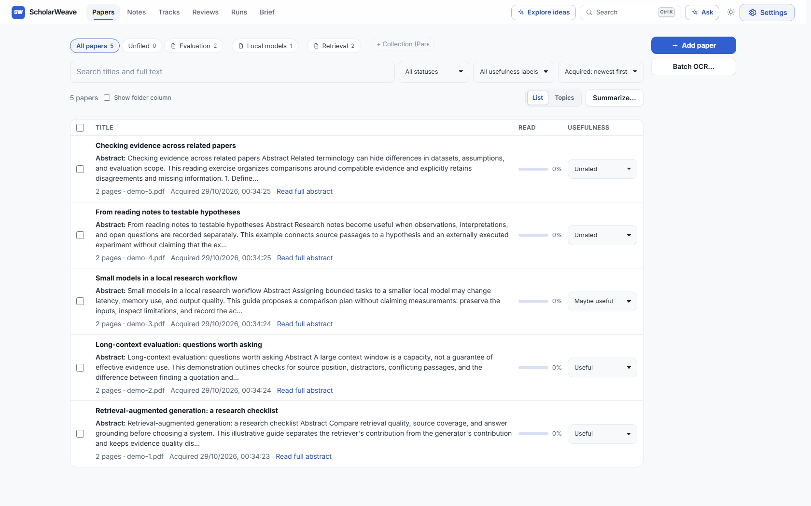
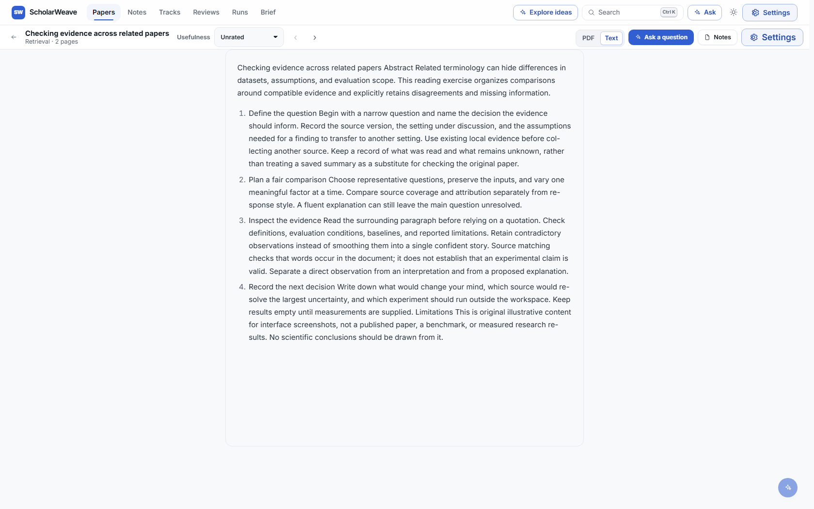
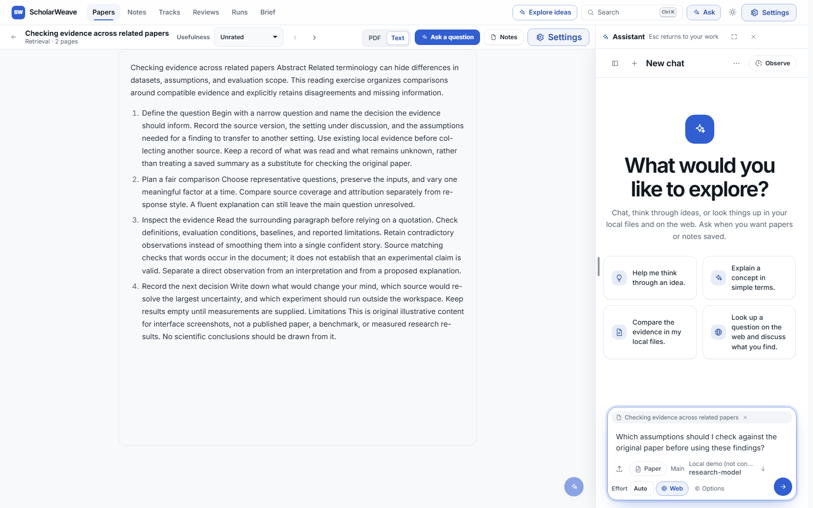
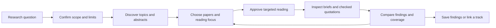
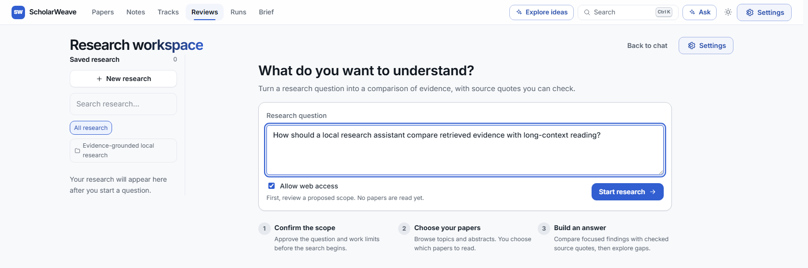
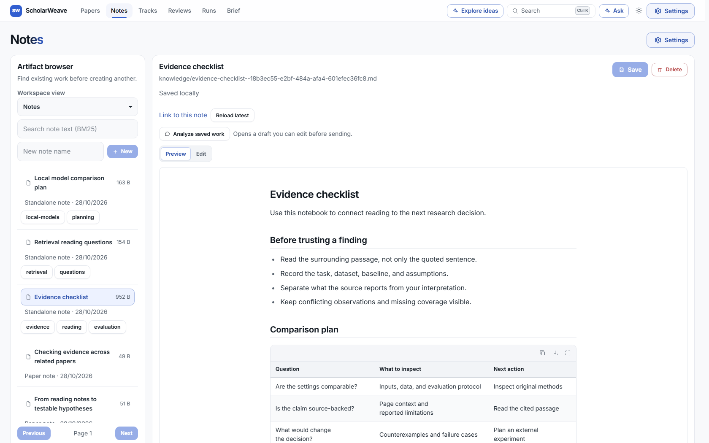
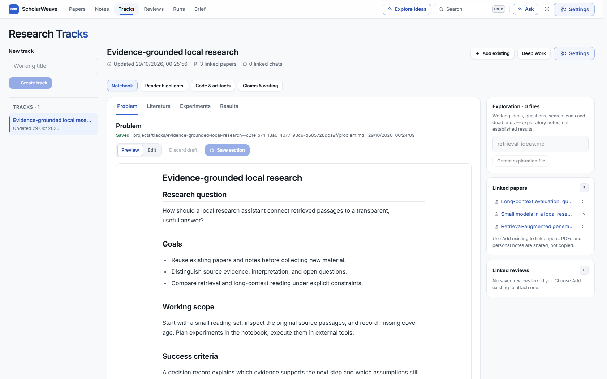
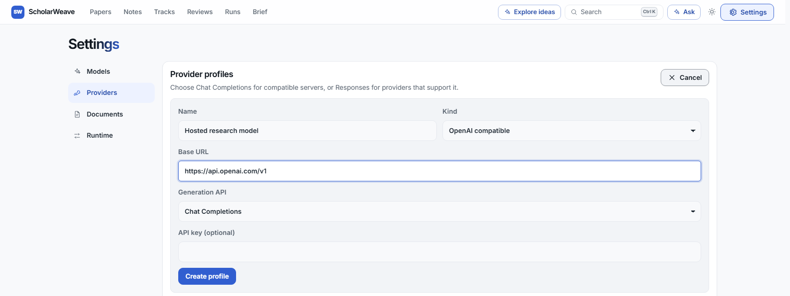

# ScholarWeave

**A local-first research workspace for one researcher on one machine.**

Collect papers, read PDFs and extracted text, ask questions beside your sources, and turn
research into connected notes, literature reviews, and long-lived research tracks. Start with
what you already have: ScholarWeave reuses local papers and saved evidence instead of creating
another copy or regenerating an artifact unnecessarily.

Use Ollama, a self-hosted OpenAI-compatible server such as llama.cpp, or a hosted provider with
your own API key. Your library and conversation history stay on your machine; inference runs
with the provider you choose.



Screenshots show an isolated demonstration workspace with illustrative documents, not research results.

[Get started](#get-started) · [Research workflows](#research-workflows) ·
[Models and OCR](#models-and-ocr) · [Terminal interface](#terminal-interface) ·
[Data and privacy](#data-and-privacy) · [Development](#development)

## Get started

### Requirements

- **Python 3.12+** and **Node.js 20+**.
- A model provider for chat and generation. Paper browsing, native PDF text extraction, and
  editing notes do not require a model.
- An **embedding model** for topic grouping and new topic-led reviews.
- Optional OCR: a local **Surya 2** server for layout-aware extraction, **Tesseract** with language
  data for scanned pages, or downloaded **Indra** models for quick CPU reading.

### Windows

From the repository root in PowerShell:

```powershell
python -m venv .venv
.\.venv\Scripts\python.exe -m pip install -e "."

Set-Location frontend
npm.cmd ci
Set-Location ..

powershell.exe -NoProfile -ExecutionPolicy Bypass -File .\scripts\launch-scholarweave-web.ps1
```

The web launcher builds missing or outdated frontend assets, starts or reuses the backend for
this library, and opens your browser. Unchanged launches reuse verified assets without running
npm. Keep the launcher window open for a backend it starts; **Ctrl+C** stops only that backend.

### Linux

From the repository root:

```sh
python3 -m venv .venv
.venv/bin/python -m pip install -e "."
(cd frontend && npm ci)
sh scripts/launch-scholarweave-web.sh
```

Both launchers prefer `http://127.0.0.1:1102` and automatically choose another loopback port if
needed. They discover an existing compatible backend for the same library. There is no need to
edit frontend/backend ports together. `--connect-only --api-url ...` instead requires that exact
existing server. Use `--check` for a startup-only check; the Windows script exposes it as `-Check`.

**First launch:** open **Settings > Providers**, add your provider and verify its models, then
choose defaults in **Settings > Models**. Set each model's actual context window and capabilities.
Choose an embedding model before starting a topic-led review. OCR configuration is separate from
chat configuration.

**Upgrading an older installation:** read the [workspace upgrade guide](docs/workspace-upgrade.md)
before launching against an old library. The offline upgrade backs up the files and database,
reorganizes the workspace, and retires old conversations and agent runs.

## Research workflows

The web app opens in **Papers**. Its navigation follows your research material; **Ask** brings
the assistant alongside the page instead of replacing your workspace.

| Surface | Use it for |
| --- | --- |
| **Papers** | Acquire, organize, search, prepare, and read source documents. |
| **Ask** | General chat, a focused paper question, a local/web lookup, or a draft. Open it with **Ctrl+J**. |
| **Reviews** | A research question, an approved paper shortlist, targeted reading, and evidence comparison in one workspace. |
| **Notes** | Search, read, and edit reusable notes, paper notes, summaries, and workspace files. |
| **Tracks** | Keep a problem, literature, experiment plans, and results together over time. |
| **Brief** | Browse recent research headlines and explicitly generate daily highlights. |
| **Runs** | Monitor OCR batches, page progress, errors, and recent batch history. |

Use **Search / Ctrl+K** to find papers, notes, tracks, reviews, and conversation titles/previews.
Light, sepia, and dark themes are available. Page-specific settings live in drawers so the
reading and editing surfaces stay uncluttered.

### 1. Collect, organize, and read papers

Use **Add paper** to upload a PDF, paste a PDF URL, or search arXiv. Choosing an arXiv result
fills the download form; downloading is a separate action.

- Organize papers into virtual collections, including nested names such as
  `Inference/Quantization`. Collections never move canonical PDFs, notes, or summaries.
- Search titles and extracted content with BM25-ranked results, excerpts, and page references.
  Browse 25-paper pages; filter by preparation status or your own usefulness labels.
- Read abstract previews directly in the list, expand them in place, and sort by acquisition
  date or title. Previews reuse stored text; listing papers does not generate summaries.
- Switch to **Topics** for embedding-based grouping. Saved topic names and memberships persist;
  new papers join existing topics without renaming the library. Move individual or selected
  papers between saved topics explicitly.
- Resume from **Continue reading**. Reading progress comes from your saved page position, not
  an inferred measure of understanding.

Open a paper to switch between the original **PDF** and extracted **Text**, inspect preparation
details, keep paper notes, or use summary tools. Text supports Markdown, tables, equations, and
source figure crops when the extraction provides them. A stable paper folder keeps its PDF,
notes, canonical summary, immutable summary versions, and evidence together.



### 2. Ask beside your sources

Use **Ask a question** in the reader to carry the current paper into the assistant, or open
**Ask** from any page. The **Paper** picker can reuse a prepared workspace paper in the current
chat without uploading it again. The assistant pane is resizable.

Chat supports **Auto** and **Quick** per message, with local sources, attachments, and an
independent web-access control. Effort resets to Auto after sending. General conversation,
explanations, brainstorming, and narrow lookups do not need a research plan; substantial scoped
assignments can maintain one. Longer investigations belong in **Reviews**, not a Thorough chat
toggle.

Attach Markdown, plain text, or PDFs and describe the task. Uploads are stored and indexed
locally; PDFs use the paper preparation pipeline. Default limits are **10 attachments per
message**, **2 MiB per UTF-8 text file**, and **40 MiB per PDF**. Extracted attachment text must
also fit the text limit. Removing a draft attachment does not delete the saved source.

Summaries stay in chat unless you ask to save them. Discussing a saved summary does not
regenerate it. Ask explicitly to update notes or a track; discussion alone does not save files.
For recurring tasks, use the bundled or locally authored Markdown [skills](docs/skills.md).

**Observe** exposes tool activity, work plans, usage, and delegated work; **Focus** prioritizes
reading. You can steer an active run, stop it, or request an answer from the evidence collected
so far. The chat **Context** setting controls compaction; your model server must support the
window you select.



### 3. Build an evidence-backed review

Open **Reviews** to enter the **Research workspace**. Start with a question, confirm scope and
work limits, then choose which papers deserve a closer read.



The initial landscape includes up to **24 papers**. Topics and recommendations are based on
titles and abstracts, not a full-paper assessment. No arbitrary reading batch is preselected:
select papers, supply a reading focus, and approve **Read selected papers**. Expand the shortlist
with arXiv results or PDF links without automatically downloading or reading those additions.

New reviews read question-matched passages and produce progressive paper briefs with
verbatim-checked page quotations. These are **targeted, partial readings**, not full-paper audits.
Inspect original sources and coverage before relying on a finding. **Findings** exposes the
available evidence and cross-paper comparison; agreements, differences, and unknowns remain
distinct. Checking that a quotation matches its source does not validate the scientific claim.

Paper decisions, investigation history, work plans, and follow-ups share one workspace and one
composer. **Saved research** restores previous work. Pause research or stop and summarize valid
partial findings; resume and new paper-reading approvals remain explicit. Navigating away does
not cancel backend work.

**Explore ideas** also works independently of a review. Develop, challenge, combine, or simplify
directions without collecting PDFs or requiring embeddings. Literature-check actions prepare
an editable research question rather than silently starting a review.

Review folders retain candidates, selections, PDF copies, extracted sources, briefs, receipts,
and reports under `workspace/research/`. Older full-reading reviews remain accessible as saved
history; their API/terminal controls differ from the current web workflow. See
[review workflows and recovery](docs/research-tracks.md#staged-literature-reviews).



### 4. Turn reading into reusable notes and research tracks

**Notes** searches standalone notes, paper notes, and saved summaries with tags and ranked
excerpts. Switch to the workspace tree to browse library, research, project, and attachment
files. Edit Markdown directly; revision checks protect newer saves and preserve conflicting
drafts. Generated receipts and managed files remain read-only outside their owning workflow.

When asked to take notes, the assistant looks for related saved work first, appends findings
without replacing prior content, and can link supporting notes. Say **"only this note"** to
restrict the destination. Refresh the workspace index after external file edits; application
edits update it automatically.



Use **Tracks** for a longer-lived problem. Each track keeps **Problem**, **Literature**,
**Experiments**, and **Results** documents plus an **Exploration** folder for tentative ideas,
search leads, and rejected approaches. Link existing papers and conversations without copying
their canonical notes or summaries.

Experiments have stable `EXP-001`-style identifiers and explicit states, from Suggested or
Planned to Running, Completed, Blocked, or Cancelled. Execution happens in your external tools;
record supplied measurements and distinguish observations from interpretation.

Tracks also connect research to writing and external artifacts:

- **References:** manage stable citation keys and bibliographic metadata; import/export the
  supported BibTeX and RIS subset independently of PDF acquisition.
- **Code & artifacts:** explicitly authorize an existing local repository, inspect code and saved
  outputs without executing them, and attach artifact receipts to experiment IDs.
- **Claims & writing:** connect statements to supporting, contradictory, or contextual source
  quotations; draft Markdown with citation and claim links; export saved drafts as Markdown,
  LaTeX, or DOCX. Unresolved references or claims block export.
- **History and round-tripping:** recover section revisions, export Markdown or a track ZIP,
  and preview externally edited imports before merging or explicitly replacing content.



See [research track organization](docs/research-tracks.md) for document formats, evidence
contracts, linked repositories, and import/export.

### 5. Keep up with recent work

**Brief** collects a headline-first reading list from arXiv, official labs, technical blogs,
and framework releases. Edit interests, exclusions, sources, and the reading window in its
settings. Collection and cached browsing do not need a model or paid feed.

**Download PDF/page** opens a temporary preview. **Keep in library** explicitly saves a PDF
or source-attributed workspace note, reusing existing content where possible. **Discard**
dismisses temporary content; **Clear fetched data** never deletes kept library files or
archived highlights.

**Generate highlights** explicitly starts model-written paragraphs based on collected titles,
abstracts, and publisher metadata, without downloading extra sources. Opening or refreshing
the page does not generate them. Completed daily highlights persist and are available through
**Past highlights**. The temporary edition is cached for the day in your configured timezone;
this is not an always-on scheduler when the app is closed.

## Models and OCR

### Choose the models you want

In **Settings > Providers**, configure the compatible base URL, optional API key, available
models, capabilities, and real context windows. **Edit URL** changes a saved provider's host or
port without recreating its models or assignments.

**Generation API** explicitly selects **Chat Completions** (the default) or **Responses**.
Keep the API base URL, usually ending in `/v1`, rather than an individual `/responses` path.
Responses uses local history, `store=false`, and application function tools, not hosted tools.
Unsupported endpoints report an error instead of silently switching protocols.

**Settings > Models > Small tasks** can assign a smaller helper for supported background tasks
such as briefs and conversation compaction; dedicated **Paper summaries** and **Context
maintenance** assignments can override it. Main chat, research planning, comparisons, and
library topic naming still use the main model. Explicit task choices take precedence, and
assignment changes apply to new work.

Provider-level reasoning defaults and tool-specific overrides are optional. If a deployment
rejects reasoning with function tools, use its supported protocol or set the tool reasoning
override to `none`. Do not assume every OpenAI-compatible model supports tools, vision, or
structured outputs.



### Prepare PDFs locally

Native embedded text is the lightweight option for selectable PDFs. For layout-aware
extraction, choose **Surya 2** in **Settings > Documents** and connect an already-running local
server:

| Setting | Starting value |
| --- | --- |
| Server URL | `http://localhost:18080/v1` |
| Model ID | `Surya-ocr-2` (must match the server's model catalog) |
| Parallel OCR pages | `10` |
| OCR output tokens | `8192` |

The server needs both the [Surya 2 model](https://huggingface.co/datalab-to/surya-ocr-2-gguf)
and its vision projector. ScholarWeave does not start the server or download its weights.
Set concurrency no higher than the server's available slots and memory/context per slot;
the starting value is not a hardware recommendation.

For an existing paper, use **Details > Extraction and indexing > Re-run with OCR**; changing
settings does not rewrite the library automatically. **Use embedded text** remains explicit.
Tesseract requires a local installation and language data. **Quick CPU OCR** uses predownloaded
Indra models; optional **Indra CPU recovery** is off by default. Download the
[Indra model files](https://huggingface.co/datalab-to/indra-ocr) at revision `v1.1.0` once,
using the local model cache or `INDRA_OCR_MODEL_DIR` for a downloaded folder. Ingestion never
downloads them automatically. Indra code is Apache-2.0, but its weights use a modified
OpenRAIL-M license. See the [OCR recipe](docs/recipes.md#change-paper-ingestion-or-ocr) for
preparation, checkpointing, and recovery behavior.

Use **Batch OCR** for selected or filtered papers and **Runs** to inspect overall paper/page
progress, speed estimates, and errors. Stop a batch without losing completed page checkpoints;
a later batch reuses them. Re-run with OCR is the explicit full-page override. Unreadable pages
and fallbacks are reported rather than silently presented as complete extraction. Original PDFs,
canonical notes, and saved summaries are preserved.

OCR and research jobs need the backend to keep running. Closing a browser tab does not stop
them; stopping an owned launcher/backend does. Equations, table values, and figure interpretation
should always be checked against the PDF.

## Terminal interface

The optional Textual client shares the same local backend, papers, notes, tracks, and chat:

```powershell
.\.venv\Scripts\python.exe -m pip install -e ".[tui]"
.\.venv\Scripts\python.exe -m scholarweave_tui
```

On Linux, use `.venv/bin/python` instead. A terminal-only launch does not need Node.js or a
frontend build. Initial provider setup, PDF import/native viewing, and track file transfers use
the web app.

| Shortcut | Action |
| --- | --- |
| **Ctrl+1 / Ctrl+2 / Ctrl+3** | Chat / Papers / Notes |
| **Ctrl+4 / Ctrl+5** | Skills / Research Tracks |
| **Ctrl+K** | Search |
| **Ctrl+M / Ctrl+G** | Model / reasoning selection |
| **Ctrl+F** | Focus mode |
| **Ctrl+S / Ctrl+E** | Save / switch editor and preview |
| **Enter / Ctrl+J** | Send / insert a newline |
| **Esc** | Stop the active run |
| **F1** | Full shortcut and command list |
| **Ctrl+Q** | Quit; stop only a backend this client started |

The cockpit starts with a fresh draft, not an automatically saved empty conversation. Existing
threads reopen from history. Slash commands include `/model`, `/reasoning`, `/effort`, `/web`,
`/tracks`, and `/review`.

For Windows desktop/Start shortcuts:

```powershell
powershell.exe -NoProfile -ExecutionPolicy Bypass -File .\install-windows-launcher.ps1
```

These shortcuts and `scripts\launch-scholarweave.ps1` open the **terminal**, not the browser.
They ensure frontend assets are current for web handoffs. Linux has the equivalent
`sh scripts/launch-scholarweave.sh`. Keep the checkout and `.venv` in place.

## Data and privacy

ScholarWeave has **no accounts, teams, collaboration, or authentication**. Run one backend
worker bound to **`127.0.0.1`**; do not expose it as a public or shared server.

Local-first is not the same as offline: web lookup contacts external sources, and the selected
model provider receives prompts and the research content needed for inference. A local provider
keeps inference local; a hosted provider is subject to that service's policies.

Provider API keys are stored **unencrypted** in the local database. Protect the data directory
and backups. Linking a repository does not automatically index or send its contents to a model.
ScholarWeave is not an IDE, code executor, experiment runner, or computer-control agent.

| Default path | Contents |
| --- | --- |
| `local_data/metadata.sqlite3` | Settings, provider credentials, conversations, runs, and operational/document metadata |
| `workspace/library/papers/<title--id>/` | Original PDFs, paper notes, canonical summaries, versions, and evidence |
| `workspace/knowledge/` | Reusable notes and archived Morning Brief highlights |
| `workspace/projects/tracks/<title--id>/` | Track documents and exploration files |
| `workspace/research/<track>/<review>/` | Review sources, selections, briefs, receipts, and reports |
| `workspace/inbox/attachments/` | Chat-uploaded Markdown/plain-text sources |
| `local_data/artifacts/` | Extraction artifacts, manifests, and cached tool results |
| `local_data/run_logs/` | Credential-redacted operational snapshots |

`SCHOLARWEAVE_DATA_DIR` and `SCHOLARWEAVE_WORKSPACE_DIR` can relocate the two roots.
Both default directories are excluded from Git. Back up **both** the database/data directory
and workspace files; review prose and research documents are not all stored in SQLite.

## Development

Install development dependencies:

```powershell
.\.venv\Scripts\python.exe -m pip install -e ".[dev]"
```

For hot UI updates, run the web launcher, then `npm.cmd run dev` from `frontend`. Vite's `/api`
proxy follows the backend's `backend-runtime.json` discovery file in the configured data
directory. Open the frontend URL Vite prints. For direct backend development:

```powershell
.\.venv\Scripts\python.exe -m uvicorn backend.app:app --reload --host 127.0.0.1 --port 1102
```

Direct Uvicorn uses a fixed port; unlike the launcher, it does not select a free one.
Backend changes require a reload/restart and may interrupt active jobs.

```powershell
# Focused backend checks; include the architecture guard for backend changes.
.\.venv\Scripts\python.exe -m pytest backend\tests\test_documents.py backend\tests\test_architecture.py

# Full backend suite: logical CPUs, capped at 20 workers; use -n 0 for debugging.
.\.venv\Scripts\python.exe -m pytest

Set-Location frontend

# Focused frontend checks; replace the filter with the affected feature.
npm.cmd test -- src/features/documents

# Full frontend suite, then type-check and production bundle.
npm.cmd test
npm.cmd run build

# Regenerate, never hand-edit, API contracts after backend schema changes.
$env:PATH = "$PWD\..\.venv\Scripts;$env:PATH"
npm.cmd run generate:api
npm.cmd run check:api
```

Keep `openapi-typescript` pinned to **7.13.0**. Optional terminal tests require the `tui` extra.
Production builds type-check application and test sources; they do not execute tests.

To refresh images against an existing **demo** installation, install Playwright and its Chromium
browser, then run `python -m scripts.capture_screenshots --base-url http://127.0.0.1:1102`.
For a separate frontend dev server, also pass `--api-url` with the demo backend origin.
The capture blocks API writes and uses saved provider catalogs instead of live model discovery;
it never submits the example chat draft. It requires a prepared paper and saved note, and
includes a track if one exists. Review the images for private content before publishing.

### Further documentation

- [Coding guide](AGENTS.md): ownership map, invariants, and validation scope.
- [Architecture](docs/architecture.md): runtime, model/tool loop, events, and storage.
- [Recipes](docs/recipes.md): focused implementation and configuration guides.
- [Research tracks](docs/research-tracks.md): notebooks, reviews, evidence, and writing.
- [Skills](docs/skills.md): reusable instruction-only research workflows.
- [Workspace upgrades](docs/workspace-upgrade.md): offline migration and backups.
